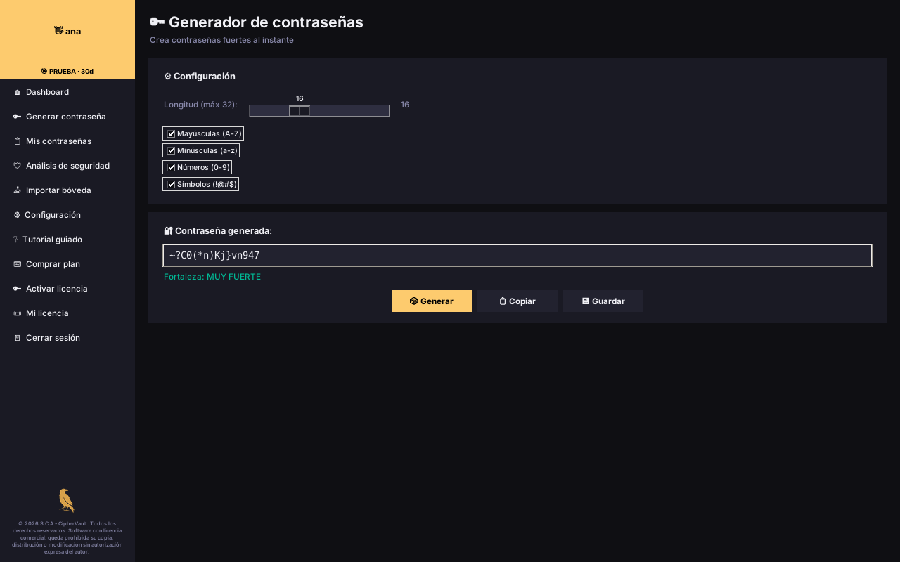

<p align="center">
  
</p>

<h1 align="center">CipherVault</h1>

<p align="center">
  Gestor de contraseñas de escritorio para <b>Windows</b> (Python 3.11 + Tkinter). Los datos viven cifrados en una base SQLite local y el <code>.exe</code> se genera con PyInstaller.<br>
  Pensado para usuarios y pymes en Colombia, con licencias por plan.
</p>

> ⚠️ **Proyecto en etapa de pruebas.** CipherVault todavía no está lista para instalar ni para comprar.


## Funciones

- **Bóveda cifrada.** Servicio, página web, usuario, contraseña, notas y clave 2FA se guardan cifrados con una clave que se deriva de la contraseña maestra y nunca se guarda en disco.
- **Auto-escritura (Ctrl + Alt + A).** En la página de inicio de sesión, CipherVault reconoce el sitio por el título de la ventana y escribe usuario y contraseña. Si hay varias cuentas, deja elegir.
- **Windows Hello.** Entrar con huella, rostro o PIN de Windows en vez de escribir la contraseña maestra.
- **Códigos 2FA (TOTP).** Guarda la clave de verificación en dos pasos y muestra el código de 6 dígitos con su cuenta regresiva.
- **Importar desde Chrome, Edge, Firefox, Bitwarden, LastPass, 1Password, KeePass y Apple** (CSV), y exportar a CSV o a `.cvault` cifrado.
- **Kit de emergencia en PDF** para imprimir y anotar la contraseña maestra a mano.
- **Sincronización entre equipos** por una carpeta de OneDrive, Google Drive o Dropbox: un archivo `.cvsync` cifrado, sin servidores propios. Mezcla los cambios de cada equipo y propaga los borrados.
- **Bóveda de equipo (plan Equipo).** Un archivo `.cvteam` en una carpeta compartida. El administrador agrega a cada empleado con su código de miembro y un rol (administrador, editor o solo lectura). Al quitar a alguien, la clave del equipo cambia.
- **Extensión para Chrome, Edge y Brave.** Rellena usuario y contraseña con un clic o con Alt + Shift + V. Solo propone cuentas del sitio abierto y avisa si la dirección no coincide.
- **Generador de contraseñas.** Longitud configurable, mayúsculas, minúsculas, números y símbolos, con medidor de fortaleza en vivo.
- **Análisis de seguridad.** Distribución de fortaleza, contraseñas repetidas, recomendaciones y búsqueda opcional en filtraciones públicas (Have I Been Pwned) sin enviar nunca la contraseña.
- **Bloqueos.** Bloqueo por intentos fallidos que sobrevive a reiniciar la app y bloqueo automático por inactividad.
- **Exportar e importar** la bóveda en archivos `.cvault` cifrados con su propia contraseña, y cambio de contraseña maestra.
- **Instalador para Windows** (Inno Setup) y firma de código del `.exe` cuando hay certificado.
- **Portapapeles que se limpia solo** a los 30 segundos de copiar una contraseña.
- **Tutorial guiado** dentro de la app.

| Mis contraseñas | Análisis de seguridad |
| --- | --- |
|  |  |
| **Generador** | **Inicio de sesión** |
|  |  |

<sub>Capturas de la app real con datos de ejemplo.</sub>

## Archivos

- `Gestor_contrasenas_secure.py`: la aplicación (interfaz, criptografía, licencias).
- `cv_extras.py`: importar/exportar CSV, códigos 2FA, kit de emergencia en PDF, auto-escritura y Windows Hello.
- `cv_sync.py`: sincronización por carpeta (`.cvsync`) y bóveda de equipo (`.cvteam`, claves X25519).
- `cv_bridge.py` y `ciphervault_bridge.py`: puente local con la extensión del navegador (`CipherVaultBridge.exe`).
- `extension/`: la extensión (Manifest V3). `extension/TIENDA.md` explica cómo publicarla y `extension/PRIVACIDAD.md` es su política de privacidad.
- `installer/CipherVault.iss`: instalador de Windows (Inno Setup 6), lo compila `build.ps1`.
- `Main.py`: punto de entrada; registra los errores de arranque en el log.
- `build.ps1`: crea el entorno, genera `desktop_runtime_config.json` (sin nada de developer) y compila `dist\CipherVault.exe`.
- `CipherVault.spec`: especificación de PyInstaller (se niega a compilar si el JSON trae claves de developer).
- `run.ps1`: ejecuta la app desde código fuente (modo desarrollo).
- `GUIA_ACTIVACION_MAKE.md`: configuración de Wompi → Make (códigos de un solo uso).
- `tests/`: pruebas automáticas (`pytest`).
- `Assets/`: logos e íconos que se empaquetan en el `.exe`.
- `docs/`: capturas e ícono del README.
- `probar_canje.py`: prueba el webhook de canje de Make sin abrir la app.
- `limpiar_datos_ciphervault.ps1`: aparta (no borra) los datos locales y el registro de Windows para empezar de cero en un equipo.

## Desarrollo

```powershell
Copy-Item .env.example .env      # rellénalo con tus valores reales
.\run.ps1
```

Pruebas:

```powershell
pip install -r requirements-dev.txt -r requirements-desktop.txt
python -m pytest tests
```

El **modo developer** (Dev Tools, plan ilimitado) solo existe al ejecutar desde código fuente y requiere `CIPHERVAULT_ENABLE_DEV_TOOLS=1` y tu hostname en `CIPHERVAULT_DEV_HOSTNAMES`. Dentro del `.exe` está desactivado siempre y la app ignora las variables de entorno `CIPHERVAULT_*`, los `.env` y los JSON sueltos: solo cuenta la configuración embebida.

## Compilar y distribuir

```powershell
.\build.ps1
```

Deja `dist\CipherVault.exe` y muestra su SHA-256. Si tienes **Inno Setup 6** instalado, también genera `dist\CipherVault-Setup-<versión>.exe` (instala por usuario, sin pedir permisos de administrador, y al desinstalar no borra la bóveda). Usa `.\build.ps1 -SkipInstaller` para saltarlo.

**Firma de código.** Con un certificado de firma de código (OV o EV), `build.ps1` firma el `.exe` y el instalador con `signtool` (Windows SDK). Configúralo en `.env` (nunca se empaqueta en el `.exe`):

```
CIPHERVAULT_SIGN_THUMBPRINT=HUELLA_SHA1          # certificado instalado en Windows o token USB
# o bien
CIPHERVAULT_SIGN_PFX=C:\ruta\certificado.pfx
CIPHERVAULT_SIGN_PFX_PASSWORD=...
``` El `.exe` incluye los links de Wompi, la URL y el secreto del servicio de activación y los precios; **no** incluye ninguna credencial de developer. Antes de publicarlo, comprueba que el build no trae secretos (el script ya lo valida). Recomendado: firmar el ejecutable con un certificado de firma de código para evitar avisos de SmartScreen y falsos positivos del antivirus.

No distribuyas: `.env`, `developer.license`, `dev_credentials.json`, `desktop_runtime_config.json` suelto.

## Seguridad (resumen)

- Contraseña maestra → clave de bóveda con **PBKDF2-HMAC-SHA256, 600.000 iteraciones**, salt propio por usuario. Una sola derivación por inicio de sesión.
- Verificación de la contraseña maestra: formato `v3$` = HMAC de la clave de bóveda; nunca se guarda la clave. Las cuentas de formatos anteriores se migran solas al iniciar sesión.
- Contraseñas, servicio, usuario y notas se cifran con **Fernet** (AES-128-CBC + HMAC) con esa clave; el SQLite no contiene texto legible.
- Bloqueo por intentos fallidos persistente (5 fallos → 30 s, 1 min, 2 min… máx. 15 min) y bloqueo automático por inactividad (configurable, 5 min por defecto).
- Exportación/importación `.cvault` cifradas con su propia contraseña; cambio de contraseña maestra (re-cifra todo en una transacción).
- Comprobación opcional de contraseñas filtradas con Have I Been Pwned (k-anonimato: solo se envían 5 caracteres del hash SHA-1).
- Los errores se registran en `%LOCALAPPDATA%\CipherVault\ciphervault.log` (nunca contraseñas ni códigos).

## Licencias y planes

Flujo de compra: la app abre el Payment Link de Wompi → Make genera un **código aleatorio por equipo**, lo envía por correo y guarda solo su hash → el cliente lo pega en «Activar licencia» → la app lo canjea contra un webhook de Make, que lo marca como usado por ese equipo y devuelve el plan firmado. **Un código sirve para un solo equipo y un solo email**; otro equipo necesita otro código. La vigencia se cuenta desde la fecha del pago, y la licencia local queda atada al PC (copiar la base de datos a otro equipo no la conserva). Pasos de Make en `GUIA_ACTIVACION_MAKE.md`.

| Plan | Contraseñas | Análisis, categorías y 2FA | Exportar | Respaldo automático | Precio |
|---|---|---|---|---|---|
| `free` | 50 | no | no | no | gratis |
| `trial` (30 días) | 50 | sí | no | no | gratis |
| `premium` | ilimitadas | sí | sí | sí | 9.900 COP/mes · 89.900 COP/año · 149.900 COP de por vida |
| `equipo` | ilimitadas | sí, + bóveda de equipo | sí | sí | 14.900 COP por usuario al mes |

Las tres opciones de Premium activan el mismo plan; solo cambia la duración que Make guarda con el código (1, 12 o 1200 meses). El plan `basic` ya no se vende, pero los códigos emitidos antes siguen funcionando (ahora con contraseñas ilimitadas). Importar CSV y la auto-escritura están disponibles en todos los planes.

La prueba gratuita guarda su fecha de inicio en tres sitios (archivo, base de datos y registro de Windows) y detecta retrocesos del reloj. El plan guardado en la base local lleva un sello de integridad ligado al equipo: editarlo a mano o copiarlo a otro PC lo invalida. Es una protección contra manipulación casual, no contra ingeniería inversa del `.exe`.

## Datos locales

`%LOCALAPPDATA%\CipherVault`: `passwords.db`, `app_config.json`, `install_date.txt`, `ciphervault.log` y la carpeta `backups` (últimos 5 respaldos cifrados, plan premium).

**Windows Hello:** la clave de la bóveda se guarda cifrada con una clave derivada de la firma que hace Windows Hello (clave RSA en el TPM del equipo, protegida por huella/rostro/PIN) sobre un reto aleatorio, y además protegida con DPAPI. Sin Windows Hello, en otro equipo u otra cuenta de Windows no se puede abrir. Cambiar la contraseña maestra lo desactiva.

## Detalles técnicos destacados

- **Una sola derivación de clave por inicio de sesión.** PBKDF2-HMAC-SHA256 a 600.000 iteraciones produce la clave de la bóveda, y la contraseña maestra se verifica con un HMAC de esa clave (formato `v3$`). Así no se guarda ni la clave ni un hash reutilizable, y las cuentas de formatos anteriores se migran solas al entrar.
- **Licencias que no se pueden compartir.** Cada pago genera un código aleatorio del que el servidor solo guarda el hash. El código se liga al primer equipo que lo canjea (identificador derivado del `MachineGuid` de Windows), y la respuesta viene firmada con un *nonce* para que no se pueda reutilizar en otro equipo. El plan guardado en la base local lleva un sello HMAC atado al equipo.
- **El `.exe` no se puede convertir en modo desarrollador.** `CipherVault.spec` se niega a compilar si la configuración trae credenciales de desarrollador, y la app compilada ignora variables de entorno, `.env` y archivos JSON sueltos.
- **Prueba gratuita difícil de reiniciar.** La fecha de inicio se guarda en tres sitios (archivo, base de datos y registro de Windows) y la app detecta si se atrasa el reloj.
- **77 pruebas automáticas**, incluidas pruebas de humo de la interfaz real con Tk que corren sin pantalla (Xvfb). Windows Hello y la auto-escritura se prueban con dobles (la parte que depende del hardware se prueba a mano en Windows).

## Soporte

ciphervaultpass@gmail.com

## Autor

**Santiago Cuervo Aldana**, de **S.C.A**. Estudiante de Ciencias de la Computación en la Universidad Nacional de Colombia, sede Manizales.

---

© 2026 S.C.A. Todos los derechos reservados. Software con licencia comercial: el código se publica para consulta; queda prohibida su copia, distribución o modificación sin autorización expresa del autor.
