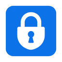
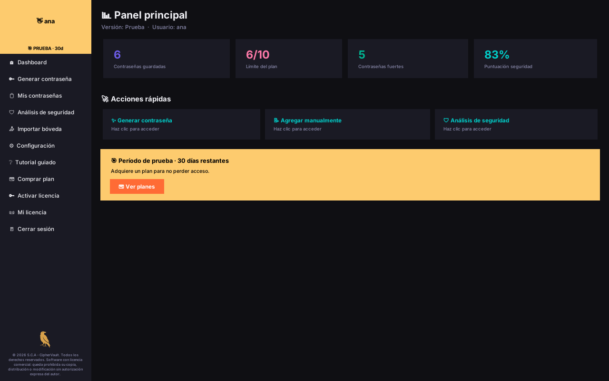
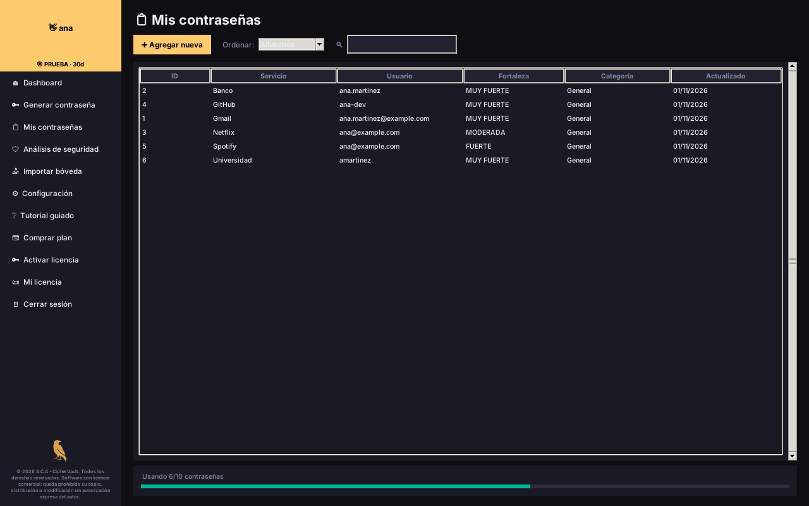
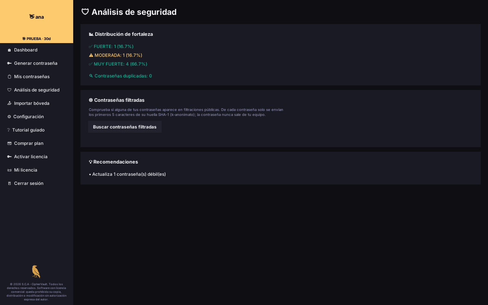
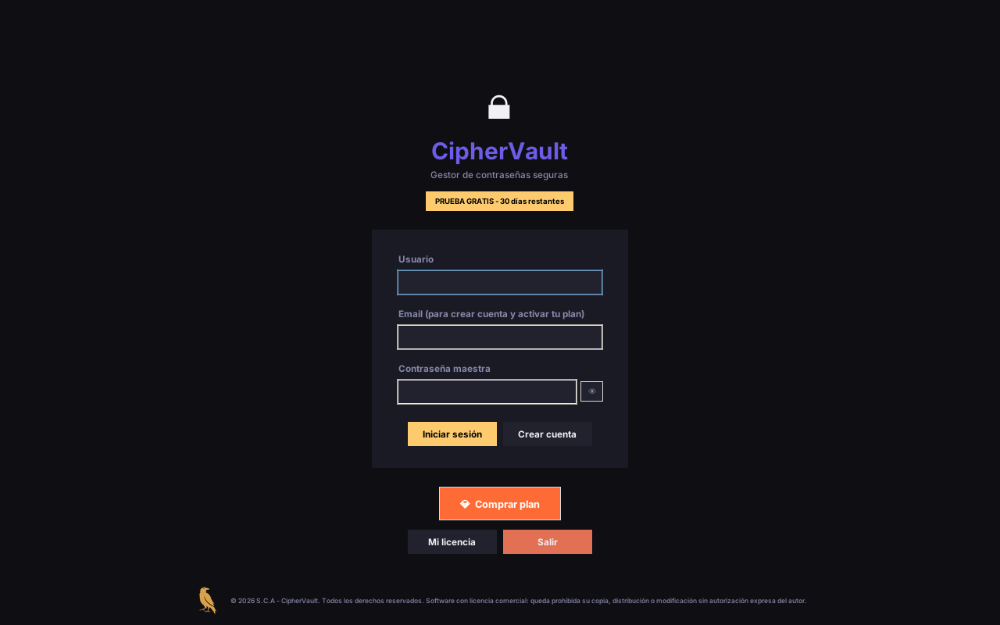

> [!CAUTION]
> **CipherVault está en beta y todavía no está lista para instalarse.** Es una versión de prueba: puede tener errores, cambiar sin aviso o perder datos. No la uses para guardar tus contraseñas reales ni la instales en equipos de trabajo hasta que salga la versión estable.

<p align="center">
  
</p>

<h1 align="center">CipherVault</h1>

<p align="center">
  Gestor de contraseñas de escritorio para <b>Windows</b> y <b>macOS</b> (Python 3.11 + Tkinter). Los datos viven cifrados en una base SQLite local y la app se genera con PyInstaller.<br>
  Pensado para usuarios y pymes en Colombia, con licencias por plan.<br>
  <a href="https://claude.ai/artifact/CE3mjxkr9kbVoju1Jr2SFo">Sitio web</a>
</p>

## Descargar

<p align="center">
  <a href="https://github.com/Camperillo30/CipherVault/releases/download/v3.3.0-beta/CipherVault-Setup.exe"><b>⬇️ Descargar para Windows</b></a> (Windows 10 y 11)
  &nbsp;·&nbsp;
  <a href="https://github.com/Camperillo30/CipherVault/releases/download/v3.3.0-beta/CipherVault-macOS.zip"><b>⬇️ Descargar para Mac</b></a> (macOS 11 o superior, chip Apple M1 o más nuevo)
  <br><sub><a href="https://github.com/Camperillo30/CipherVault/releases">Todas las versiones</a></sub>
</p>

<details>
<summary><b>Windows dice «Windows protegió su PC»</b></summary>

CipherVault todavía no tiene firma de código, así que SmartScreen muestra ese aviso la primera vez. Haz clic en **Más información** → **Ejecutar de todas formas**. El instalador no pide permisos de administrador y al desinstalar no borra tus contraseñas.
</details>

<details>
<summary><b>Mac dice que «no se puede abrir» o que es de un desarrollador no identificado</b></summary>

1. Descomprime el .zip y arrastra **CipherVault** a la carpeta **Aplicaciones**.
2. Ábrelo una vez (aparecerá el aviso) y ciérralo.
3. Ve a **Ajustes del Sistema → Privacidad y seguridad**, baja hasta el mensaje de CipherVault y pulsa **Abrir de todas formas**.

En Mac no está Windows Hello; todo lo demás funciona igual (bóveda, 2FA, sincronización, equipo, importar CSV). La auto-escritura usa **Ctrl + Option + A** y necesita dos permisos que macOS pide la primera vez: **Accesibilidad** (Ajustes del Sistema → Privacidad y seguridad → Accesibilidad → activar CipherVault y volver a abrir la app) y **Automatización** para leer la dirección de Safari, Chrome, Edge o Brave.
</details>



## Funciones

- **Bóveda cifrada.** Servicio, página web, usuario, contraseña, notas y clave 2FA se guardan cifrados con una clave que se deriva de la contraseña maestra y nunca se guarda en disco.
- **Auto-escritura (Ctrl + Alt + A en Windows, Ctrl + Option + A en Mac).** En la página de inicio de sesión, CipherVault lee la dirección de la pestaña del navegador y la compara con el dominio de la página web guardada (o, si la entrada no tiene página, con el nombre del servicio: «Netflix» sirve en netflix.com). Una página falsa que copie el título no coincide. En programas que no son navegador usa el título de la ventana. Si hay varias cuentas, deja elegir.
- **Duplicar contraseña.** Crea una entrada nueva con los datos de otra (por ejemplo, una segunda cuenta del mismo sitio) para cambiar solo lo necesario.
- **Windows Hello.** Entrar con huella, rostro o PIN de Windows en vez de escribir la contraseña maestra.
- **Códigos 2FA (TOTP).** Guarda la clave de verificación en dos pasos y muestra el código de 6 dígitos con su cuenta regresiva.
- **Verificación en dos pasos al iniciar sesión (Premium y Equipo).** Se activa en Configuración escaneando un QR con Google Authenticator, Microsoft Authenticator o similar; desde ahí, después de la contraseña maestra se pide el código de 6 dígitos. Trae 8 códigos de respaldo de un solo uso por si se pierde el celular. La clave se guarda cifrada con la bóveda, un código no se acepta dos veces y los errores cuentan para el bloqueo por intentos. Windows Hello no la pide (ya combina el equipo con la huella, el rostro o el PIN).
- **Importar desde Chrome, Edge, Firefox, Bitwarden, LastPass, 1Password, KeePass y Apple** (CSV), y exportar a CSV o a `.cvault` cifrado.
- **Kit de emergencia en PDF** para imprimir y anotar la contraseña maestra a mano.
- **Sincronización entre equipos** por una carpeta de OneDrive, Google Drive o Dropbox: un archivo `.cvsync` cifrado, sin servidores propios. Mezcla los cambios de cada equipo y propaga los borrados.
- **Bóveda de equipo (plan Equipo).** Un archivo `.cvteam` en una carpeta compartida. El administrador agrega a cada empleado con su código de miembro y un rol (administrador, editor o solo lectura). Al quitar a alguien, la clave del equipo cambia. El administrador ve un **registro de actividad** (quién creó, editó, borró o copió cada contraseña) y un **informe de seguridad del equipo** (claves débiles, repetidas, sin cambiar en 6 meses o sin 2FA).
- **Generador de contraseñas.** Longitud configurable, mayúsculas, minúsculas, números y símbolos, con medidor de fortaleza en vivo.
- **Análisis de seguridad.** Distribución de fortaleza, contraseñas repetidas, recomendaciones y búsqueda opcional en filtraciones públicas (Have I Been Pwned) sin enviar nunca la contraseña.
- **Bloqueos.** Bloqueo por intentos fallidos que sobrevive a reiniciar la app y bloqueo automático por inactividad.
- **Exportar e importar** la bóveda en archivos `.cvault` cifrados con su propia contraseña, y cambio de contraseña maestra.
- **Instalador para Windows** (Inno Setup) y firma de código del `.exe` cuando hay certificado.
- **Portapapeles que se limpia solo** a los 30 segundos de copiar una contraseña.
- **Tutorial guiado** dentro de la app.

| Mis contraseñas | Análisis de seguridad |
| --- | --- |
|  |  |
| **Generador** | **Inicio de sesión** |
|  |  |

<sub>Capturas de la app real con datos de ejemplo.</sub>

## Archivos

- `Gestor_contrasenas_secure.py`: la aplicación (interfaz, criptografía, licencias).
- `cv_extras.py`: importar/exportar CSV, códigos 2FA y verificación en dos pasos al entrar, kit de emergencia en PDF, auto-escritura y Windows Hello.
- `cv_sync.py`: sincronización por carpeta (`.cvsync`) y bóveda de equipo (`.cvteam`, claves X25519).
- `installer/CipherVault.iss`: instalador de Windows (Inno Setup 6 o 7), lo compila `build.ps1`.
- `.github/workflows/release.yml` (con `CipherVault-mac.spec`): al subir una etiqueta `v*` desde PyCharm (o al publicar un release en GitHub), GitHub Actions compila el instalador de Windows y la app de macOS (`CipherVault-macOS.zip`). Necesita los secretos `CIPHERVAULT_ACTIVATION_URL` y `CIPHERVAULT_ACTIVATION_SECRET` en *Settings → Secrets and variables → Actions*.
- `Main.py`: punto de entrada; registra los errores de arranque en el log.
- `build.ps1`: crea el entorno, genera `desktop_runtime_config.json` (sin nada de developer) y compila `dist\CipherVault.exe`.
- `CipherVault.spec`: especificación de PyInstaller (se niega a compilar si el JSON trae claves de developer).
- `run.ps1`: ejecuta la app desde código fuente (modo desarrollo).
- `GUIA_ACTIVACION_MAKE.md`: configuración de Wompi → Make (códigos de un solo uso).
- `tests/`: pruebas automáticas (`pytest`).
- `Assets/`: logos e íconos que se empaquetan en el `.exe`.
- `docs/`: capturas e ícono del README.
- `probar_canje.py`: prueba el webhook de canje de Make sin abrir la app.
- `limpiar_datos_ciphervault.ps1`: aparta (no borra) los datos locales y el registro de Windows para empezar de cero en un equipo.

## Desarrollo

```powershell
Copy-Item .env.example .env      # rellénalo con tus valores reales
.\run.ps1
```

Pruebas:

```powershell
pip install -r requirements-dev.txt -r requirements-desktop.txt
python -m pytest tests
```

El **modo developer** (Dev Tools, plan ilimitado) solo existe al ejecutar desde código fuente y requiere `CIPHERVAULT_ENABLE_DEV_TOOLS=1` y tu hostname en `CIPHERVAULT_DEV_HOSTNAMES`. Dentro del `.exe` está desactivado siempre y la app ignora las variables de entorno `CIPHERVAULT_*`, los `.env` y los JSON sueltos: solo cuenta la configuración embebida.

## Compilar y distribuir

```powershell
.\build.ps1
```

Deja `dist\CipherVault.exe` y muestra su SHA-256. Si tienes **Inno Setup 6** instalado, también genera `dist\CipherVault-Setup-<versión>.exe` (instala por usuario, sin pedir permisos de administrador, y al desinstalar no borra la bóveda). Usa `.\build.ps1 -SkipInstaller` para saltarlo.

**Firma de código.** Con un certificado de firma de código (OV o EV), `build.ps1` firma el `.exe` y el instalador con `signtool` (Windows SDK). Configúralo en `.env` (nunca se empaqueta en el `.exe`):

```
CIPHERVAULT_SIGN_THUMBPRINT=HUELLA_SHA1          # certificado instalado en Windows o token USB
# o bien
CIPHERVAULT_SIGN_PFX=C:\ruta\certificado.pfx
CIPHERVAULT_SIGN_PFX_PASSWORD=...
```

El `.exe` incluye los links de Wompi, la URL y el secreto del servicio de activación y los precios; **no** incluye ninguna credencial de developer. Antes de publicarlo, comprueba que el build no trae secretos (el script ya lo valida). Recomendado: firmar el ejecutable con un certificado de firma de código para evitar avisos de SmartScreen y falsos positivos del antivirus.

No distribuyas: `.env`, `developer.license`, `dev_credentials.json`, `desktop_runtime_config.json` suelto.

### Publicar una versión

1. Sube `APP_VERSION` en `Gestor_contrasenas_secure.py` (por ejemplo a `3.2.0`) y haz *Commit and Push* en PyCharm.
2. Crea la etiqueta en PyCharm (*Git > New Tag*): `v3.2.0` para una versión definitiva, o `v3.2.0-beta` (con guion) para una pre-release.
3. Súbela: *Git > Push*, con la casilla **Push tags** marcada.

GitHub Actions crea el release y le sube el instalador de Windows, la versión portable y la app de macOS. Si la etiqueta no coincide con `APP_VERSION`, se detiene sin compilar. También sigue funcionando publicar un release desde la web de GitHub.

## Seguridad (resumen)

- Contraseña maestra → clave de bóveda con **PBKDF2-HMAC-SHA256, 600.000 iteraciones**, salt propio por usuario. Una sola derivación por inicio de sesión.
- Verificación de la contraseña maestra: formato `v3$` = HMAC de la clave de bóveda; nunca se guarda la clave. Las cuentas de formatos anteriores se migran solas al iniciar sesión.
- Contraseñas, servicio, usuario y notas se cifran con **Fernet** (AES-128-CBC + HMAC) con esa clave; el SQLite no contiene texto legible.
- Bloqueo por intentos fallidos persistente (5 fallos → 30 s, 1 min, 2 min… máx. 15 min) y bloqueo automático por inactividad (configurable, 5 min por defecto).
- Exportación/importación `.cvault` cifradas con su propia contraseña; cambio de contraseña maestra (re-cifra todo en una transacción).
- Comprobación opcional de contraseñas filtradas con Have I Been Pwned (k-anonimato: solo se envían 5 caracteres del hash SHA-1).
- Los errores se registran en `%LOCALAPPDATA%\CipherVault\ciphervault.log` (nunca contraseñas ni códigos).

## Licencias y planes

Flujo de compra: la app abre el Payment Link de Wompi → Make genera un **código aleatorio**, lo envía por correo y guarda solo su hash → el cliente lo pega en «Activar licencia» → la app lo canjea contra un webhook de Make, que registra ese equipo en el código y devuelve el plan firmado. **Un código sirve para un solo email y hasta 3 equipos** (por ejemplo, PC de la casa, portátil y PC del trabajo); un cuarto equipo se rechaza. La vigencia se cuenta desde la fecha del pago, y la licencia local queda atada al PC (copiar la base de datos a otro equipo no la conserva). Pasos de Make en `GUIA_ACTIVACION_MAKE.md`.

| Plan | Contraseñas | Análisis, categorías y 2FA | Exportar | Respaldo automático | Precio |
|---|---|---|---|---|---|
| `free` | 50 | no | no | no | gratis |
| `premium` | ilimitadas | sí | sí | sí | 9.900 COP/mes · 89.900 COP/año · 149.900 COP de por vida |
| `equipo` | ilimitadas | sí, + bóveda compartida, registro de actividad e informe de seguridad del equipo | sí | sí | por mes: 3 personas 24.900 (8.300 c/u) · 5 personas 37.900 (7.580 c/u) · 10 personas 64.900 (6.490 c/u) · hasta 100 personas 199.900 (máximo del plan) |

Los paquetes de Equipo los paga la empresa en un solo pago mensual, y cada persona sale más barata que un Premium individual (9.900). Make envía al correo del pago 3, 5 o 10 códigos (uno por persona) o, en el paquete grande, un código de empresa para máximo 100 usuarios (100 equipos). Estos códigos **no** están atados al correo: cada empleado los activa en su propia cuenta. La app primero prueba el código con el correo de la cuenta y, si no existe, como código de equipo.

Las tres opciones de Premium activan el mismo plan; solo cambia la duración que Make guarda con el código (1, 12 o 1200 meses). El plan `basic` ya no se vende, pero los códigos emitidos antes siguen funcionando (ahora con contraseñas ilimitadas). Importar CSV y la auto-escritura están disponibles en todos los planes.

Ya no hay período de prueba: se empieza en el plan gratis (50 contraseñas, sin análisis, categorías ni 2FA). El plan guardado en la base local lleva un sello de integridad ligado al equipo: editarlo a mano o copiarlo a otro PC lo invalida. Es una protección contra manipulación casual, no contra ingeniería inversa del `.exe`.

## Datos locales

`%LOCALAPPDATA%\CipherVault`: `passwords.db`, `app_config.json`, `install_date.txt`, `ciphervault.log` y la carpeta `backups` (últimos 5 respaldos cifrados, plan premium).

**Windows Hello:** la clave de la bóveda se guarda cifrada con una clave derivada de la firma que hace Windows Hello (clave RSA en el TPM del equipo, protegida por huella/rostro/PIN) sobre un reto aleatorio, y además protegida con DPAPI. Sin Windows Hello, en otro equipo u otra cuenta de Windows no se puede abrir. Cambiar la contraseña maestra lo desactiva.

## Detalles técnicos destacados

- **Una sola derivación de clave por inicio de sesión.** PBKDF2-HMAC-SHA256 a 600.000 iteraciones produce la clave de la bóveda, y la contraseña maestra se verifica con un HMAC de esa clave (formato `v3$`). Así no se guarda ni la clave ni un hash reutilizable, y las cuentas de formatos anteriores se migran solas al entrar.
- **Licencias que no se pueden compartir.** Cada pago genera un código aleatorio del que el servidor solo guarda el hash. El código se liga a los equipos que lo canjean, hasta 3 (identificador derivado del `MachineGuid` de Windows), y la respuesta viene firmada con un *nonce* para que no se pueda reutilizar en otro equipo. El plan guardado en la base local lleva un sello HMAC atado al equipo.
- **El `.exe` no se puede convertir en modo desarrollador.** `CipherVault.spec` se niega a compilar si la configuración trae credenciales de desarrollador, y la app compilada ignora variables de entorno, `.env` y archivos JSON sueltos.
- **Prueba gratuita difícil de reiniciar.** La fecha de inicio se guarda en tres sitios (archivo, base de datos y registro de Windows) y la app detecta si se atrasa el reloj.
- **75 pruebas automáticas**, incluidas pruebas de humo de la interfaz real con Tk que corren sin pantalla (Xvfb). Windows Hello y la auto-escritura se prueban con dobles (la parte que depende del hardware se prueba a mano en Windows).

## Soporte

ciphervaultpass@gmail.com

## Autor

**Santiago Cuervo Aldana**.

---

© 2026 S.C.A. Todos los derechos reservados. Software con licencia comercial: el código se publica para consulta; queda prohibida su copia, distribución o modificación sin autorización expresa del autor.
